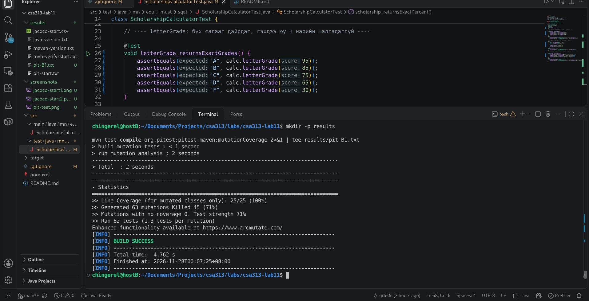
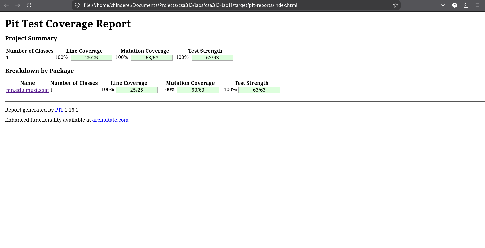

# F.CSA313 - Лабораторийн ажил 11

- **Оюутны нэр:** С.Чингэрэл
- **Оюутны код:** B232270010

### Орчин ба ашигласан хэрэгслүүд

Үзүүлэлт Хувилбар / мэдээлэл

---

Үйлдлийн систем Debian GNU/Linux
Java OpenJDK 21.0.13.1
Maven Apache Maven 3.9.9
PIT 1.16.1

Java:

```text
openjdk version "21.0.13.1" 2026-11-17
OpenJDK Runtime Environment (build 21.0.13.1+2-1-deb13u1-Debian)
OpenJDK 64-Bit Server VM (build 21.0.13.1+2-1-deb13u1-Debian, mixed mode, sharing)
```

Maven:

```text
Apache Maven 3.9.9
Maven home: /usr/share/maven
Java version: 21.0.13.1, vendor: Debian
Runtime: /usr/lib/jvm/java-21-openjdk-amd64
Default locale: en_US
Platform encoding: UTF-8
OS name: "linux", version: "6.12.117-amd64", arch: "amd64"
```

### Ажлын зорилго

Энэхүү лабораторийн ажлын зорилго нь PIT Mutation Testing ашиглан эхний
тестийн багцын сул талыг илрүүлэх, амьд үлдсэн мутантуудыг шинжлэх,
тестийн assertion-уудыг сайжруулах шаардлагыг тодорхойлох юм.

Line Coverage өндөр байх нь тестүүд программын зөв үр дүнг баталгаажуулж
байна гэсэн үг биш. Mutation Testing нь кодын жижиг өөрчлөлтийг тестүүд
илрүүлж чадаж байгаа эсэхийг шалгана.

### Эхний тестийн багц

Эхний `ScholarshipCalculatorTest` тестийн багцад дараах шалгалтууд
байсан.

---

Функц Эхний тестийн шалгалт Илэрсэн сул тал

---

`letterGrade()` `assertNotNull()` Яг `"A"`, `"B"`, `"C"`,
`"D"`, `"F"` буцаж
байгааг шалгаагүй

`letterGrade()` `assertThrows()` Хүчингүй утгын
хүчингүй оролт exception-ийг шалгасан

`gpa()` `assertTrue()`-ээр 0--4 Бодит GPA утгыг
муж шалгасан шалгаагүй

`gpa()` хүчингүй оролт `assertThrows()` `null`, хоосон массивыг
шалгасан

`scholarship()` `assertTrue()`-ээр Тэтгэлгийн яг хувийг
0--100 муж шалгасан шалгаагүй

`scholarship()` `assertThrows()` GPA болон кредитийн
хүчингүй оролт хүчингүй утгыг шалгасан

---

Жишээ нь, `assertNotNull(calc.letterGrade(95))` нь `"A"` гэсэн зөв утгыг
шаардахгүй. Мөн `assertTrue(gpa >= 0 && gpa <= 4)` нь буруу GPA утга
тухайн мужид багтаж байвал тестийг амжилттай болгоно.

### PIT-ийн эхний тайлан

PIT тайлангийн ерөнхий үзүүлэлт:

Үзүүлэлт Үр дүн

---

Мутаци үүсгэсэн 63
Killed 17
Mutation coverage / score 27%
Мутациас шалтгаалсан line coverage 25/25 (100%)
Test strength 17/63 (27%)
PIT-ийн ажиллуулсан тестийн тоо 97
Нэг мутацид ногдох тестийн дундаж 1.54

PIT тайлангийн хувилбар: **PIT 1.16.1**.

**Тайлбар:** 100% Line Coverage нь бүх мөр дор хаяж нэг удаа ажилласныг
илэрхийлнэ. Харин Mutation Score 27% байгаа нь кодын өөрчлөлтийг
илрүүлэх тестийн чадвар сул байгааг харуулж байна.

### Хэсэг A --- Амьд мутантуудыг ангилах

PIT тайлан дахь `SURVIVED` төлөвтэй мутантуудыг дараах хоёр ангиллаар
авч үзэв.

- **Тест дутуу:** Мутаци нь программын үр дүнг өөрчилж болох боловч
  одоогийн assertion тухайн өөрчлөлтийг илрүүлээгүй.
- **Equivalent:** Мутаци хийсэн ч программын ажиглагдах зан төлөв
  өөрчлөгдөхгүй тул тестээр ялгах боломжгүй.

#### Амьд мутантуудын хүснэгт

Доорх хүснэгтэд PIT HTML тайлангийн screenshot-уудаас уншигдсан
мутантуудыг нэгтгэв. Нэг мөрөнд ижил төрлийн хэд хэдэн мутант байж
болно.

---

Кодын мөр PIT-ийн мутацийн тайлбар Ангилал Шаардлагатай арга
хэмжээ

---

20 `changed conditional boundary` Тест дутуу `letterGrade()`-ийн 0
болон 100 заагийн
утгыг шалгах

23--27 `removed conditional - replaced comparison check with true/false` Тест дутуу Үнэлгээний салаа
бүрийн буцаах утгыг
яг шалгах

23--27 `changed conditional boundary` Тест дутуу 90, 80, 70, 60 зааг
болон тэдгээрийн
өмнөх/дараах утгыг
шалгах

23--27 `replaced return value with ""` Тест дутуу F үнэлгээнд `"F"`
буцаж байгааг
`assertEquals`-ээр
шалгах

36 `Changed switch default to be first case` Equivalent гэж Java `switch`-ийн
үзсэн `default` байрлалыг
өөрчлөхөд тохирох
`case`-ийн сонголт
өөрчлөгдөхгүй

38 `Replaced double addition with subtraction` Тест дутуу B үнэлгээний GPA-ийн
яг үр дүнг шалгах

40 `Replaced double addition with subtraction` Тест дутуу D үнэлгээний GPA-ийн
яг үр дүнг шалгах

44 `replaced double return with 0.0` Тест дутуу GPA-ийн бодит
дундажийг шалгах

48 `changed conditional boundary` Тест дутуу GPA болон кредитийн
хязгаарын утгуудыг
шалгах

48 `removed conditional - replaced comparison check with true/false` Тест дутуу Хүчингүй оролтын
нөхцөлүүдийг тус
тусад нь шалгах

51 `removed conditional - replaced comparison check with true/false` Тест дутуу `hasViolation`-ийн
true болон false
нөхцөлийн үр дүнг
шалгах

51 `replaced int return with 0` Тест дутуу `hasViolation=true`
үед 0, бусад нөхцөлд
зөв тэтгэлгийн утга
буцаж байгааг шалгах

52--54 `changed conditional boundary` Тест дутуу 3.8, 3.4, 3.0 GPA
болон 15, 12
кредитийн заагийг
шалгах

52--54 `removed conditional - replaced comparison check with true/false` Тест дутуу 100, 70, 50 болон 0
хувийн үр дүнг яг
шалгах

---

**Тэмдэглэл:** Дээрх мөрийн бүлэглэл нь screenshot-д харагдсан PIT
тайлбаруудыг нэгтгэсэн болно. Popup-д хэд хэдэн мутант хамт харагдсан
хэсэгт мутант бүрийн дэд дугаар болон яг мөрийн хамаарлыг тусад нь
баталгаажуулах шаардлагатай. Screenshot-д харагдаагүй мутантыг энэ
хүснэгтэд нэмээгүй.

#### Ангиллын үндэслэл

**Тест дутуу:** `letterGrade()`-ийн тестүүд зөвхөн буцаасан утга `null`
биш эсэхийг шалгасан. `gpa()` болон `scholarship()`-ийн тестүүд бодит үр
дүнг бус зөвхөн утгын мужийг шалгасан. Иймээс буцаах утга болон
нөхцөлийн оператор өөрчлөгдсөн мутантууд тестээр илрээгүй.

**Equivalent:** `switch` бүтцийн `default` хэсгийг эхэнд байрлуулах нь
Java-ийн `switch`-ийн зан төлөвийг өөрчлөхгүй. Тохирох `case` олдоогүй
үед `default` ажилладаг тул `default`-ийн байрлал өөрчлөгдсөн ч үр дүн
ижил байна.

### Тестийг сайжруулах чиглэл

Дараагийн шатанд сул assertion-уудыг бодит хүлээгдэж буй үр дүнг шалгах
assertion-уудаар солих шаардлагатай.

---

Функц Сул шалгалт Сайжруулсан шалгалтын жишээ

---

`letterGrade(95)` `assertNotNull(...)` `assertEquals("A", calc.letterGrade(95))`

`letterGrade(85)` `assertNotNull(...)` `assertEquals("B", calc.letterGrade(85))`

`letterGrade(75)` `assertNotNull(...)` `assertEquals("C", calc.letterGrade(75))`

`letterGrade(65)` `assertNotNull(...)` `assertEquals("D", calc.letterGrade(65))`

`letterGrade(30)` `assertNotNull(...)` `assertEquals("F", calc.letterGrade(30))`

`gpa()` Зөвхөн 0--4 муж Тооцоолсон GPA-г
`assertEquals(expected, actual, delta)`-ээр
шалгах

`scholarship()` Зөвхөн 0--100 муж Хүлээгдэж буй тэтгэлгийн хувийг
`assertEquals(expected, actual)`-ээр шалгах

---

Хязгаарын утгуудыг шалгахдаа утга бүрийн яг доод, зааг дээрх, яг дээд
утгуудыг сонгоно. Жишээлбэл, `letterGrade()`-ийн 90, 80, 70, 60 заагийг
тус бүр шалгана.

### B1 — Шалгалтын баталгаажуулалтыг сайжруулах (Strengthen Assertions)

Энэ алхамд сул шалгалтуудыг `assertEquals()` ашиглан хүлээгдэж буй утгыг яг таг шалгадаг болгож өөрчилсөн.

Ингэснээр тестийн багц нь програмын буруу ажиллагааг илрүүлэх чадвараа сайжруулсан.

| Үзүүлэлт                                                                     | Эхний үр дүн | B1 дараах |
| ---------------------------------------------------------------------------- | -----------: | --------: |
| Үүсгэсэн мутацийн тоо (Generated Mutations)                                  |           63 |        63 |
| Устгагдсан мутацийн тоо (Killed Mutations)                                   |           17 |        45 |
| Мутацийн хамрах хүрээ / Тестийн үр нөлөө (Mutation Coverage / Test Strength) |          27% |       71% |
| Мөрийн хамрах хүрээ (Line Coverage)                                          |         100% |      100% |

Шалгалтын баталгаажуулалтыг сайжруулсны дараа мутацийн оноо 27%-аас 71% болж өссөн. Энэ нь зөвхөн утга `null` биш эсэхийг шалгах эсвэл тодорхой мужид байгаа эсэхийг баталгаажуулахаас илүүтэйгээр хүлээгдэж буй утгыг `assertEquals()` ашиглан яг таг шалгах нь мутацийн тестийг илрүүлэхэд илүү үр дүнтэй болохыг харуулж байна.



### B2 — Заагийн утгын тест нэмэх (Boundary Value Tests)

Энэ алхамд `letterGrade()`, `gpa()` болон `scholarship()` функцүүдийн заагийн утгуудыг шалгах нэмэлт тестүүдийг оруулсан.

`letterGrade()` функцийн A, B, C, D, F үнэлгээний босго утгууд болон тэдгээрийн өмнөх утгуудыг шалгасан. `gpa()` функцийн A, B, C, D, F үнэлгээний бүх салааг хамруулсан. Мөн `scholarship()` функцийн GPA болон кредитийн босго утгууд, зөвшөөрөгдөх оролтын хязгааруудыг шалгасан.

Нэмэлтээр GPA 0-ээс бага утгатай үед `IllegalArgumentException` үүсэхийг шалгах тест оруулсан. Үүний үр дүнд өмнө нь амьд үлдсэн мутаци устгагдсан.

| Үзүүлэлт | B1 дараах | B2 дараах |
|---|---:|---:|
| Generated Mutations | 63 | 63 |
| Killed Mutations | 45 | 63 |
| Mutation Coverage | 71% | 100% |
| Test Strength | 71% | 100% |
| Line Coverage | 100% | 100% |

B2 алхмын дараа мутацийн хамрах хүрээ 71%-аас 100% болж өссөн. Нийт 63 мутациас 63-ыг нь тестүүд илрүүлж, амьд үлдсэн мутаци үлдээгүй. Энэ нь заагийн утгын тестүүд болон оролтын хязгаарын шалгалтууд тестийн үр нөлөөг нэмэгдүүлснийг харуулж байна.



### C1 — Гараар мутаци хийх (Manual Mutation Testing)

Энэ алхамд `ScholarshipCalculator.java` файлын `scholarship()` функц доторх:

`gpa >= 3.8` нөхцөлийг түр хугацаанд `gpa > 3.8` болгон өөрчилсөн.

Ингэснээр GPA яг 3.8 байх үед 100%-ийн тэтгэлэг олгох нөхцөл алдагдсан.

`mvn test` командыг ажиллуулахад дараах үр дүн гарсан:

- Tests run: 10
- Failures: 1
- Errors: 0
- Skipped: 0
- Expected: 100
- Actual: 70
- Build: FAILURE

`scholarship_boundaryValues()` тест нь GPA 3.8 болон 15 кредитийн заагийн утгыг шалгаж, зориудаар оруулсан алдааг амжилттай илрүүлсэн. Энэ нь тестийн багц зөвхөн кодын мөрийг ажиллуулахаас гадна логикийн өөрчлөлтийг илрүүлэх чадвартайг харуулж байна.

### C2 — Эквивалент мутаци (Equivalent Mutant)

Энэ алхамд `gpa()` функцийн A үнэлгээний тооцооллыг `total += 4` хэлбэрээс `total = total + 4` болгон өөрчилсөн.

Эдгээр хоёр бичиглэл нь ижил математик үйлдлийг гүйцэтгэдэг бөгөөд програмын гаралтын үр дүнд ямар нэгэн өөрчлөлт оруулахгүй. Иймээс тестүүд уг өөрчлөлтийг алдаа гэж илрүүлэх боломжгүй бөгөөд энэ нь эквивалент мутацийн жишээ юм.

`mvn clean test` командыг ажиллуулахад бүх тест амжилттай болсон.

### Дүгнэлт

Эхний PIT тайлангаар 63 мутаци үүсэж, 17 нь устгагдсан бөгөөд mutation
score 27% байв. Line Coverage 100% байсан ч эхний тестүүд бодит буцаах
утгуудыг бүрэн баталгаажуулаагүй. `assertNotNull` болон муж шалгасан
`assertTrue` assertion-ууд нь буруу үр дүнг илрүүлэхэд хангалтгүй байв.
Иймээс `letterGrade()`, `gpa()`, `scholarship()` функцүүдийн яг
хүлээгдэж буй үр дүнг шалгах `assertEquals` assertion нэмэх
шаардлагатай. Мөн нөхцөлийн зааг утгуудыг хамарсан тестүүд хэрэгтэй.
`switch default`-ийн байрлалын өөрчлөлтийг Equivalent гэж үзсэн.
Дараагийн шатанд тестүүдийг сайжруулж PIT тайланг дахин ажиллуулан
Mutation Score-ийн өөрчлөлтийг харьцуулна.

### Ашигласан командууд

```bash
java -version
mvn -version
xdg-open target/pit-reports/index.html
mvn test
mvn verify
```
